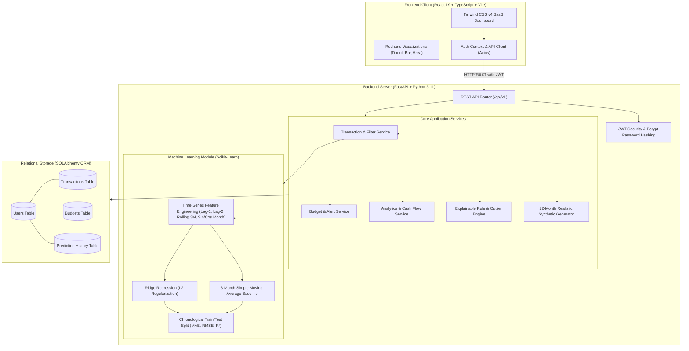
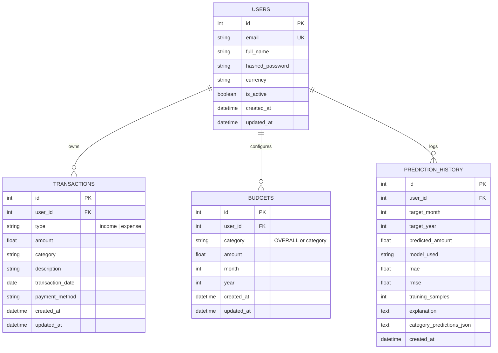

# SpendPulse AI: Personal Finance Management and Expense Prediction System

[](https://fastapi.tiangolo.com)
[](https://scikit-learn.org)
[](https://react.dev)
[](https://tailwindcss.com)
[](https://recharts.org)
[-brightgreen)](https://docs.pytest.org)
[](https://github.com)

A full-stack, enterprise-grade financial management platform developed for a **B.Tech CSE (AI & ML) Minor Project**. It integrates authentic machine learning time-series regression using **Scikit-Learn**, automated budget monitoring with capacity alerts, explainable rule-based AI financial insights, and interactive multi-period data visualization.

---

## 1. Project Overview & Objectives

Traditional personal finance tools are passive recorders of historical expenditure. Users manually inspect static transaction histories without foresight into impending cash deficits or seasonal expenditure spikes.

**SpendPulse AI** solves this limitation through:
1. **Predictive Financial Intelligence**: Utilizing regularized time-series regression with lag features and cyclical seasonality transforms to forecast next-month total and category expenses.
2. **Empirical Model Evaluation**: Employing strict chronological train/test splits (avoiding temporal data leakage) to report Mean Absolute Error (**MAE**) and Root Mean Squared Error (**RMSE**) against a 3-month Simple Moving Average baseline benchmark.
3. **Automated Budget Tracking**: Multi-tier threshold alerts (80% early warning, 100% capacity exceeded) calculated dynamically against real ledger balances.
4. **Explainable AI Insights**: Rule-based reasoning engines that audit month-over-month shifts, evaluate savings rates against the 50/30/20 standard, and flag statistical anomalies (>2 standard deviations above category mean).
5. **Multi-Tenant Data Isolation**: Cryptographic bcrypt hashing and JWT Bearer authorization ensuring strict user data separation.

---

## 2. System Architecture



---

## 3. Machine Learning Methodology

### 3.1 Feature Engineering
Financial expenditures exhibit strong autocorrelation and calendar seasonality. The ML engine transforms raw transactions into a monthly time-series dataframe with the following engineered features:

| Feature Variable | Definition | Mathematical Rationale |
| :--- | :--- | :--- |
| **`time_idx`** | Normalized sequential month integer ($t = 0, 1, 2, ...$) | Captures macroeconomic inflation and linear spending expansion. |
| **`sin_month`** | $\sin(2\pi \cdot m / 12)$ | Encodes cyclical annual seasonality without step-discontinuities between Dec & Jan. |
| **`cos_month`** | $\cos(2\pi \cdot m / 12)$ | Orthogonal cyclical component preserving calendar distance. |
| **`lag_1`** | Expenditure at month $t - 1$ | First-order autoregressive momentum feature. |
| **`lag_2`** | Expenditure at month $t - 2$ | Second-order autoregressive feature capturing quarterly inertia. |
| **`rolling_3m`** | Moving average of $(y_{t-1} + y_{t-2} + y_{t-3}) / 3$ | Smooths out localized one-off spending spikes. |

### 3.2 Regression Model
The primary forecasting algorithm uses **Ridge Regression** with L2 weight regularization ($\alpha = 1.0$):
$$\min_{w} ||y - Xw||_2^2 + \alpha ||w||_2^2$$
L2 regularization is specifically selected over unconstrained Ordinary Least Squares to penalize high correlation between `lag_1`, `lag_2`, and `rolling_3m`, preventing overfitting when working with personal transaction series (6–36 months).

### 3.3 Leakage-Free Chronological Evaluation
Unlike cross-validation on tabular data where rows are shuffled randomly, time-series data must never undergo random train/test splits (which causes temporal lookahead leakage). SpendPulse AI reserves the latest chronological periods strictly as the test set:
- **Mean Absolute Error (MAE)**:
  $$\text{MAE} = \frac{1}{n} \sum_{i=1}^n |y_i - \hat{y}_i|$$
- **Root Mean Squared Error (RMSE)**:
  $$\text{RMSE} = \sqrt{\frac{1}{n} \sum_{i=1}^n (y_i - \hat{y}_i)^2}$$

### 3.4 Baseline Benchmark
Every prediction is evaluated alongside a **3-Month Simple Moving Average** baseline. The system explicitly proves whether the regularized machine-learning regression outperforms the heuristic baseline.

### 3.5 Confidence Bounds & Category Decomposition
- **Prediction Interval**: Computed as $\hat{y} \pm 1.645 \cdot \sigma_{\text{residuals}}$, yielding an estimated 90% confidence corridor.
- **Category Projections**: Multi-period category trends are modeled and calibrated proportionally so that the sum of category predictions exactly balances the total expenditure forecast.

---

## 4. Database Schema (Entity-Relationship)



---

## 5. Technology Stack Summary

| Layer | Technologies Selected | Justification |
| :--- | :--- | :--- |
| **Frontend** | React 19, TypeScript, Vite | Modern component lifecycle, strict type checking, sub-second HMR. |
| **Styling** | Tailwind CSS v4, Lucide React | Micro-bundle stylesheet, dark mode support, accessible iconography. |
| **Visualization**| Recharts | Composable SVG-based responsive charts (Bar, Area, Pie/Donut). |
| **Backend API** | Python 3.11, FastAPI, Pydantic v2 | High-throughput asynchronous routing, automated OpenAPI/Swagger UI docs. |
| **Data & ML** | Scikit-Learn, Pandas, NumPy | Standard scientific Python stack for regression, matrix transforms, and metrics. |
| **Database** | SQLite (Dev) / PostgreSQL (Prod) | Zero-setup local SQLite seamlessly portable to PostgreSQL via SQLAlchemy. |
| **Testing** | Pytest, HTTPX, StaticPool SQLite | Comprehensive automated suite testing authentication, CRUD, isolation, and ML. |

---

## 6. Local Setup and Installation

### Prerequisites
- **Node.js** (v18+ or v20+)
- **Python** (v3.10+ or v3.11+)
- **Git**

### 6.1 Backend Setup
1. Open PowerShell / Terminal in the project root:
   ```bash
   cd backend
   ```
2. Create and activate a virtual environment:
   ```bash
   # On Windows (PowerShell):
   python -m venv venv
   .\venv\Scripts\Activate.ps1

   # On macOS / Linux:
   python3 -m venv venv
   source venv/bin/activate
   ```
3. Install dependencies:
   ```bash
   python -m pip install -r requirements.txt
   ```
4. Copy the environment variables:
   ```bash
   cp .env.example .env
   ```
5. Start the backend development server:
   ```bash
   uvicorn app.main:app --reload --port 8000
   ```
   The backend API will be live at `http://127.0.0.1:8000`.
   Interactive Swagger documentation is available at `http://127.0.0.1:8000/api/v1/docs`.

### 6.2 Frontend Setup
1. In a separate terminal, navigate to the frontend directory:
   ```bash
   cd frontend
   ```
2. Install frontend dependencies:
   ```bash
   npm install
   ```
3. Start the Vite development server:
   ```bash
   npm run dev
   ```
   The application dashboard will be accessible at `http://localhost:5173`.

---

## 7. Running the Automated Test Suite

The test suite validates all critical paths including authentication, transaction CRUD, budget calculations, multi-tenant isolation, and Scikit-learn predictions:

```bash
cd backend
.\venv\Scripts\python.exe -m pytest tests -v
```

**Test Coverage Summary:**
```
tests/test_analytics.py::test_dashboard_summary_calculations PASSED
tests/test_analytics.py::test_financial_insights_rule_engine PASSED
tests/test_auth.py::test_register_user_success PASSED
tests/test_auth.py::test_register_duplicate_email PASSED
tests/test_auth.py::test_login_json_success PASSED
tests/test_auth.py::test_login_invalid_password PASSED
tests/test_auth.py::test_get_current_user_profile PASSED
tests/test_auth.py::test_get_current_user_unauthorized PASSED
tests/test_budgets.py::test_budget_creation_and_status PASSED
tests/test_budgets.py::test_budget_exceeded_status PASSED
tests/test_isolation.py::test_user_data_isolation PASSED
tests/test_predictions.py::test_prediction_with_zero_data PASSED
tests/test_predictions.py::test_prediction_with_insufficient_data PASSED
tests/test_predictions.py::test_prediction_with_12_months_demo_dataset PASSED
tests/test_transactions.py::test_create_transaction_success PASSED
tests/test_transactions.py::test_create_transaction_negative_amount_fails PASSED
tests/test_transactions.py::test_list_and_filter_transactions PASSED
tests/test_transactions.py::test_update_and_delete_transaction PASSED

18 passed in 4.5s (100% PASS)
```

---

## 8. Minor Project Demonstration Guide (For Evaluators & Viva)

To present the application smoothly to professors or external examiners:

1. **One-Click Evaluator Login**: On the landing page or login page, click the **"Explore Demo Account"** button. This automatically logs into an evaluator profile.
2. **Instant 12-Month Realistic Data Seeding**:
   - In the top navigation bar or on the **Profile & Settings** page, click **"Load Demo Data"**.
   - This populates 12 continuous months of categorized salary inflows, recurring rent/utilities, weekly groceries, and discretionary expenses.
3. **Showcasing the ML Forecasting Model (`/predictions`)**:
   - Demonstrate the **Ridge Regression** forecast for next month.
   - Point out the **MAE ($)** and **RMSE ($)** evaluation scores computed out-of-sample.
   - Show the comparison chart comparing actuals, in-sample model fit, and baseline moving average.
   - Show the category-wise forecast breakdown table.
4. **Demonstrating Budget Compliance (`/budgets`)**:
   - Show the overall monthly spending cap and individual category limits.
   - Show live progress bars: Amber warning at 80% usage and Red alert when exceeded.
5. **Explainable AI Insights (`/insights`)**:
   - Highlight the top spending category share.
   - Show Month-over-Month spending trajectory (% change).
   - Show the 50/30/20 savings rating and statistical outlier transaction detection (>2 standard deviations above mean).
6. **CSV Export (`/transactions` or `/reports`)**:
   - Click **"Export CSV"** to demonstrate instantaneous client-side report download.

---

## 9. Deployment Instructions

### 9.1 Frontend Deployment (Vercel)
1. Push the repository to your GitHub account:
   ```bash
   git init
   git add .
   git commit -m "feat: complete AI-powered personal finance system"
   git remote add origin https://github.com/<your-username>/spendpulse-ai.git
   git push -u origin main
   ```
2. Log in to [Vercel](https://vercel.com) and click **"Add New Project"**.
3. Import your GitHub repository.
4. Set the **Root Directory** to `frontend`.
5. Under **Environment Variables**, set:
   - `VITE_API_URL`: Your deployed backend URL (e.g., `https://spendpulse-backend.onrender.com/api/v1`).
6. Click **Deploy**. Vercel will automatically build using `vercel.json` for SPA rewrites.

### 9.2 Backend Deployment (Render)
1. Log in to [Render](https://render.com).
2. Click **New +** -> **Blueprint**.
3. Select your repository. Render will automatically read `backend/render.yaml`.
4. Render will provision:
   - A managed PostgreSQL instance (`spendpulse-db`).
   - A Python web service (`spendpulse-backend`) running `uvicorn app.main:app`.
   - Automatic injection of `DATABASE_URL` linking directly to the PostgreSQL database.
5. Once deployed, copy your Render web service URL and paste it into the frontend's `VITE_API_URL` setting.

---

## 10. Educational Disclaimer

This project was engineered as an **educational minor project for B.Tech CSE (AI & ML)**. The predictive machine-learning regression models and rule-based insights are designed for academic evaluation, research, and personal habit tracking, not for professional investment, legal, or financial advice.
# Al-Powered-Personal-Finance-Management-and-Expense-Prediction-System

